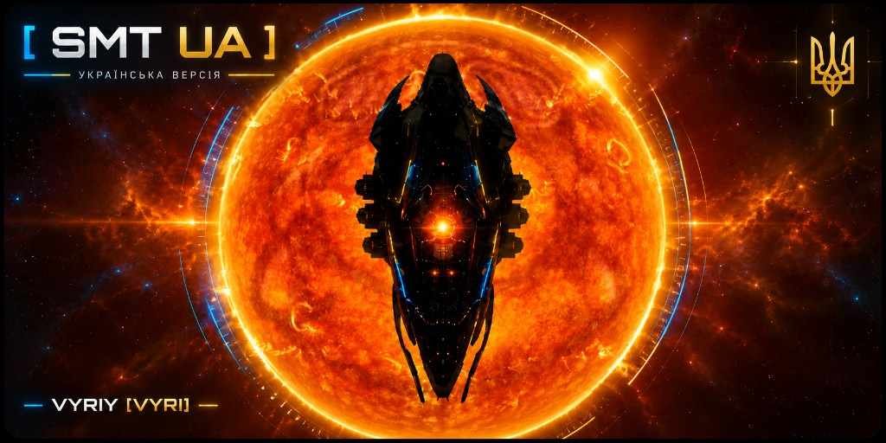

# SMT UA

SMT UA — українська збірка оригінальної карти [SMT](https://github.com/Slazanger/SMT) автора Slazanger. Автор оригіналу — Slazanger. Ця сторінка лише поширює збірку на основі його роботи і не замінює його авторство.

Програма поширюється за ліцензією MIT. Copyright (c) 2023 Slazanger.

## Встановлення

1. Постав [.NET 8 Desktop Runtime](https://dotnet.microsoft.com/download/dotnet/8.0), якщо його ще немає.
2. Завантаж архів зі сторінки [Releases](https://github.com/FuryRoad-Odmen/smt-ua/releases) і розпакуй його в окрему теку.
3. Запусти `SMT.exe`. Окремого інсталятора немає: програма працює з теки, куди її розпакували.

Налаштування зберігаються в `%APPDATA%\SMT` під час звичайного закриття вікна. Цю теку не треба копіювати разом із програмою.

## Персонаж

1. У клієнті EVE увійди тим пілотом, якого вестиме карта.
2. У SMT відкрий **Файл → Персонажі → Додати персонажа**.
3. Увійди у браузері, який відкриється, і закрий вікно авторизації, коли персонаж з’явиться у списку.
4. Зверху вікна SMT обери його в полі **Активний персонаж**.

Позиція на карті береться з ESI. Якщо пілот не рухається по карті, у **Файл → Налаштування → Загальні** увімкни **Використовувати ESI для позицій персонажів** і зайди персонажем ще раз.

## Журнали EVE

SMT читає чат і бойовий журнал із теки `Документи\EVE\logs`. У ній мають бути підтеки `Chatlogs` і `Gamelogs`. Канал інтелекту має бути відкритий у клієнті, інакше нових рядків не буде.

Якщо журнал лежить в іншому місці, відкрий **Файл → Налаштування → Загальні** і натисни **Встановити власну теку журналів**. Після зміни теки SMT треба перезапустити.

## Інтелект

1. Відкрий **Файл → Налаштування → Інтелект**.
2. У полі каналів напиши назву каналу інтелекту, по одному каналу на рядок. Досить частини назви, як у файлі журналу.
3. У фільтрах очищення додай слова, якими в каналі знімають загрозу, наприклад `clr`.
4. Увімкни звук попередження і за потреби небезпечну зону. Ближчий контакт звучить голосніше, дальший тихіше.

Поки канал підключений, вкладка інтелекту і кнопка внизу показують його назву. Довгий рядок згортається в один. Подвійний клік розкриває його і ховає знову.

## Оверлей

Оверлей відкривається разом із SMT, і кліки крізь нього проходять у гру. Щоб зсунути або закрити вікно, вимкни пропуск кліків: **Вигляд → Перемкнути кліки наскрізь для оверлея** або `Shift+Ctrl+Alt+T`.

Якщо оверлей закрили, його знову відкриває **Файл → Оверлей**. Положення вікна і режим кліків запам’ятовуються.