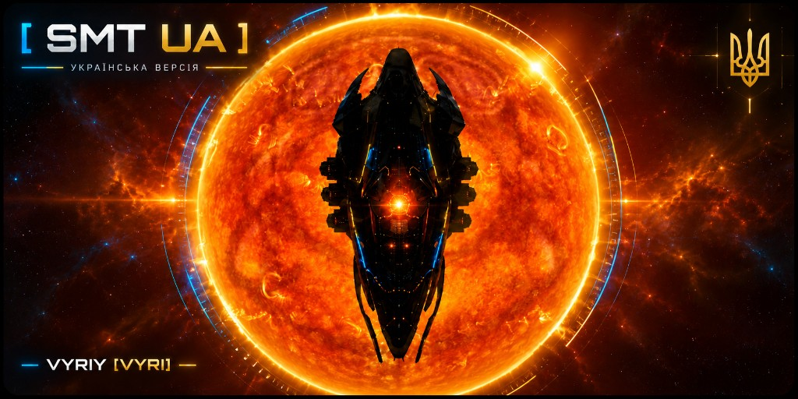

# SMT UA

SMT UA: українська версія оригінальної карти [SMT](https://github.com/Slazanger/SMT) автора Slazanger. Це окрема програма на основі його коду, зі своїм інтерфейсом, українською мовою, Intel і оверлеєм. Автор оригіналу: Slazanger.

Програма поширюється за ліцензією MIT. Copyright (c) 2023 Slazanger.

## Що нового у версії 1.2 (9 листопада 2026)

- Підказка в оверлеї з’являється над тією системою, де курсор, на будь-якому масштабі Windows. Раніше на екранах із масштабом 150% чи 200% (ноутбуки з високою роздільністю, 4K) вона спливала над іншою системою ближче до кута екрана або навіть коли курсор був поза оверлеєм.
- Куточок для зміни розміру оверлея на таких екранах більше не дрібний: він росте разом із масштабом.

## Що нового у версії 1.1 (8 листопада 2026)

- Програма більше не закривається сама через якийсь час, коли увімкнено оверлей.
- Оверлей показує те саме, що й карта. Кружки йдуть за фільтром карти: вбивства НПЦ, кораблів, подів або стрибки. Системи фарбуються за безпекою чи ADM так само, як на карті.
- Лінії в оверлеї як на карті: гейти мають свій колір усередині сузір’я, між сузір’ями і між регіонами. Мости та маршрут мають ті самі кольори, штрихи й анімацію, а вимкнена в налаштуваннях анімація вимикається і тут.
- Вбивства пілотів (кораблі та поди) тепер темно-червоні, як безпека нулів, на карті й в оверлеї. Вбивства НПЦ лишилися зеленими.
- Розмір оверлея змінюється за куточок унизу праворуч, навіть коли кліки проходять наскрізь. Карта в оверлеї розтягується разом із вікном.
- На карті знову працює підказка над системою, де стоїть твій пілот.
- Карта регіону більше не гальмує з часом, коли в ньому є вихід у Thera або Turnur. Раніше позначка виходу додавалася заново кожні 2 секунди і старі не прибиралися. Виправлення з оригінального SMT.

## Встановлення

1. Постав [.NET 8 Desktop Runtime](https://dotnet.microsoft.com/download/dotnet/8.0), якщо його ще немає.
2. Завантаж архів зі сторінки [Releases](https://github.com/FuryRoad-Odmen/smt-ua/releases) і розпакуй його в окрему теку.
3. Запусти `SMT.exe`. Окремого інсталятора немає: програма працює з теки, куди її розпакували.

Налаштування зберігаються в `%APPDATA%\SMT` під час звичайного закриття вікна. Цю теку не треба копіювати разом із програмою.

## Персонаж

1. У клієнті EVE увійди тим пілотом, якого вестиме карта.
2. У SMT відкрий **Файл → Персонажі → Додати персонажа**.
3. Увійди у браузері, який відкриється, і закрий вікно авторизації, коли персонаж з’явиться у списку.
4. Зверху вікна SMT обери його в полі **Активний персонаж**.

Позиція на карті береться з ESI. Якщо пілот не рухається по карті, у **Файл → Налаштування → Загальні** увімкни **Використовувати ESI для позицій персонажів** і зайди персонажем ще раз.

## Журнали EVE

SMT читає чат і бойовий журнал із теки `Документи\EVE\logs`. У ній мають бути підтеки `Chatlogs` і `Gamelogs`. Канал Intel має бути відкритий у клієнті, інакше нових рядків не буде.

Якщо журнал лежить в іншому місці, відкрий **Файл → Налаштування → Загальні** і натисни **Встановити власну теку журналів**. Після зміни теки SMT треба перезапустити.

## Intel

1. Відкрий **Файл → Налаштування → Інтел**.
2. У полі каналів напиши назву каналу Intel, по одному каналу на рядок. Досить частини назви, як у файлі журналу.
3. У фільтрах очищення додай слова, якими в каналі знімають загрозу, наприклад `clr`.
4. Увімкни звук попередження і за потреби небезпечну зону. Ближчий контакт звучить голосніше, дальший тихіше.

Поки канал підключений, вкладка Intel і кнопка внизу показують його назву. Довгий рядок згортається в один. Подвійний клік розкриває його і ховає знову.

## Оверлей

Оверлей відкривається разом із SMT, і кліки крізь нього проходять у гру. Щоб зсунути або закрити вікно, вимкни пропуск кліків: **Вигляд → Перемкнути кліки наскрізь для оверлея** або `Shift+Ctrl+Alt+T`.

Розмір змінюється за куточок унизу праворуч. Фільтр кружків і фарбування систем оверлей бере з панелі над картою, тож перемикай їх там.

Якщо оверлей закрили, його знову відкриває **Файл → Оверлей**. Положення вікна, розмір і режим кліків запам’ятовуються.