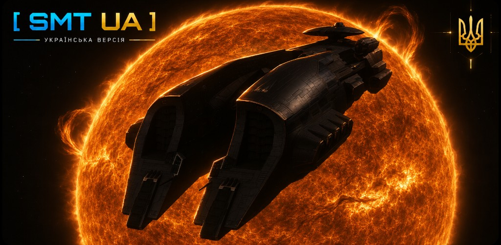

# SMT UA

SMT UA це збірка карти [SMT](https://github.com/Slazanger/SMT) автора Slazanger з переробленим інтерфейсом і своїми інструментами для полювання й безпеки. Карта, Intel і оверлей лишились основою. Зверху додано те, чого в оригіналі немає: кнопка D-Scan відправляє спрямований скан на dscan.info з системи, де стоїть пілот, а кнопка Local бере список людей у локалі і дає посилання на звіт localthreat. Ліцензія MIT. Copyright (c) 2023 Slazanger.

Що змінилось у кожній версії, написано на сторінці [релізів](https://github.com/FuryRoad-Odmen/smt-ua/releases).

Це вже зроблена робота, і її є куди продовжувати. Якщо збірка корисна, чайові в [банці Монобанку](https://send.monobank.ua/jar/2otjtBDKqm) допомагають її покращувати. Грати можна без них. Гроші йдуть автору цієї збірки, не автору оригінального SMT.

## Що є зараз

**Карта.** Регіон і всесвіт, маршрут, мости, безпека систем. Пілот на карті береться з ESI. Фільтри над картою фарбують системи і кружки: вбивства, стрибки, ADM.

**Оверлей.** Повторює карту: ті самі кольори, лінії і фільтр. Кліки проходять у гру. Розмір тягнеться за кут. Підказка системи темна, як у клієнті, і стоїть біля тієї системи, де курсор. Прозорість фону, вмісту і ліній окрема.

**Intel.** Читає журнал каналу з `Документи\EVE\logs`. Рядок із системою малює помаранчевий диск на карті й оверлеї. Продовження того самого автора не ставить другий диск і не грає звук знову. Три звуки за відстанню: близько, далі і локал. Свій D-Scan можна лишити без звуку, чужі звучать.

**D-Scan.** Кнопка біля персонажа бере скопійований спрямований скан і систему, де стоїть пілот. На сайт ідуть кораблі. У буфері лишається рядок із системою і посиланням, його вставляють в Intel. На карті диск, у стрічці число кораблів.

**Local.** Кнопка поруч бере скопійований список локала і кладе в буфер рядок із системою і посиланням на звіт.

**zKill.** Свіжий кіл це темно-червоний диск на системі. Він тане, поки кіл є на дошці. Коло вбивств пілотів за годину фіолетове.

**Помічник зору.** Вимкнений, поки його не увімкнути. Прозоре поле ставлять на дрібні кольорові значки в клієнті. Кольори задаються списком. Поки колір у полі, грає звук і ліворуч світиться кружок. Поле має лишатися майже прозорим. Справа кнопки D, L і M. M глушить звук, поки колір не зникне. Якщо значок моргає, сигнал не скидається на темному кадрі. Налаштування на окремій вкладці після «Оверлей».

**Мова.** Перший запуск англійською. Мову обирають у Файл, Налаштування. Є українська, англійська і ще кілька десятків мов.

## Як почати

1. Постав [.NET 8 Desktop Runtime](https://dotnet.microsoft.com/download/dotnet/8.0), якщо його ще немає.
2. Завантаж архів зі сторінки [релізів](https://github.com/FuryRoad-Odmen/smt-ua/releases) і розпакуй у окрему теку.
3. Запусти `SMT.exe`. Інсталятора немає. Наступний реліз програма підхоплює сама під час запуску, якщо архів встиг скачатися. Налаштування в `%APPDATA%\SMT` не чіпаються.

Персонаж: у клієнті увійди пілотом, у SMT відкрий Файл, Персонажі, Додати персонажа, увійди в браузері. Зверху обери його як активного. Якщо пілот не рухається по карті, у Файл, Налаштування, Загальні увімкни використання ESI для позицій і зайди персонажем ще раз.

Журнали: SMT читає `Документи\EVE\logs`, підтеки `Chatlogs` і `Gamelogs`. Канал Intel має бути відкритий у клієнті. Іншу теку журналів задають у Файл, Налаштування, Загальні, після цього SMT перезапускають.

Intel: Файл, Налаштування, Інтел. Назви каналів, по одній на рядок, досить частини назви з файла журналу. У фільтрах очищення слова на кшталт `clr`.

Оверлей відкривається разом із SMT. Щоб зсунути вікно, вимкни пропуск кліків: Вигляд, Перемкнути кліки наскрізь для оверлея, або `Shift+Ctrl+Alt+T`. Якщо оверлей закрили, його знову відкриває Файл, Оверлей.

## English

SMT UA is a build of the [SMT](https://github.com/Slazanger/SMT) map by Slazanger, with a reworked interface and its own tools for the hunt and for staying safe. The map, Intel, and the overlay are still the base. On top of that are things the original does not have: the D-Scan button sends a directional scan to dscan.info from the system the pilot is in, and the Local button takes the local list and makes a localthreat report link. MIT license. Copyright (c) 2023 Slazanger.

What changed in each version is on the [releases](https://github.com/FuryRoad-Odmen/smt-ua/releases) page.

That work is already in the program, and there is more to do. If the build is useful, a tip in the [Monobank jar](https://send.monobank.ua/jar/2otjtBDKqm) helps keep improving it. The program stays free without one. The money goes to the author of this build, not to the author of the original SMT.

### What is here now

**Map.** Region and universe, route, bridges, system security. Your pilot on the map comes from ESI. The filters above the map color systems and circles: kills, jumps, ADM.

**Overlay.** It repeats the map: the same colors, lines, and filter. Clicks pass through to the game. Drag the corner to resize. The system tip is dark, like the client, and sits on the system under the cursor. Background, content, and lines each have their own opacity.

**Intel.** Reads the channel log from `Documents\EVE\logs`. A line with a system draws an orange disk on the map and the overlay. A follow-up from the same writer does not add a second disk or play the sound again. Three sounds by distance: close, farther, and local. Your own D-Scan can stay silent. Other scans still sound.

**D-Scan.** The button by your character takes a copied directional scan and the system the pilot is in. Only ships go to the site. The clipboard becomes a line with the system and a link. Paste that line into Intel. The map shows a disk, the feed shows the ship count.

**Local.** The button next to it takes a copied local list and puts a line with the system and a report link on the clipboard.

**zKill.** A fresh kill is a dark red disk on the system. It fades while the kill is still on the board. Pilot kills for the hour are a purple ring.

**Vision aid.** Off until you turn it on. A transparent field sits on small colored marks in the client. You set the colors in a list. While a listed color is in the field, a sound plays and a circle lights on the left. Keep the field almost transparent. On the right are D, L, and M. M mutes the sound until the color leaves. A blinking mark does not drop the signal on a dark frame. The settings are on their own tab, right after Overlay.

**Language.** The first launch is English. Choose the language in File, Settings. Ukrainian, English, and several dozen other languages are included.

### Getting started

1. Install the [.NET 8 Desktop Runtime](https://dotnet.microsoft.com/download/dotnet/8.0) if it is not there yet.
2. Download the archive from [releases](https://github.com/FuryRoad-Odmen/smt-ua/releases) and unpack it into its own folder.
3. Run `SMT.exe`. There is no installer. On the next launch SMT picks up a newer release once the archive has downloaded. Settings in `%APPDATA%\SMT` stay where they are.

Character: log the pilot into the client, then in SMT open File, Characters, Add character, and sign in in the browser. Pick that pilot as active at the top. If the pilot does not move on the map, turn on ESI positions under File, Settings, General, and sign the character in again.

Logs: SMT reads `Documents\EVE\logs`, with `Chatlogs` and `Gamelogs` inside. The Intel channel has to be open in the client. Another log folder is set under File, Settings, General. Restart SMT after that.

Intel: File, Settings, Intel. Channel names, one per line. Part of the name from the log file is enough. Clear filters are words such as `clr`.

The overlay opens with SMT. To move the window, turn off click-through: View, Toggle overlay click-through, or `Shift+Ctrl+Alt+T`. If you closed it, File, Overlay opens it again.
